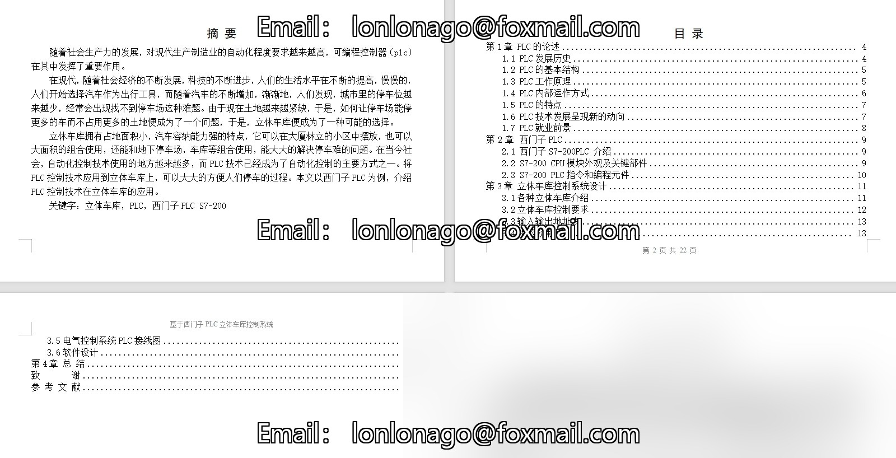

# Design of a three-dimensional garage control system based on PLC

## Body

Design of a 3D garage control system based on PLC; design of PLC garage control system; 462 This material contains only articles and is for reference only.

The material covers a PLC-based sturdor garage control system design, along with PLC discussions, basic structure, working principles, features and related technical content.

<!-- AI_ENRICHED -->

## Images

## Payment

Here is a pay link on Stripe ( https://buy.stripe.com/3cs8yP7sY87d0vu9AB ). Please contact me lonlonago@foxmail.com after funding $89, and I will send you a complete data files , thank you!

